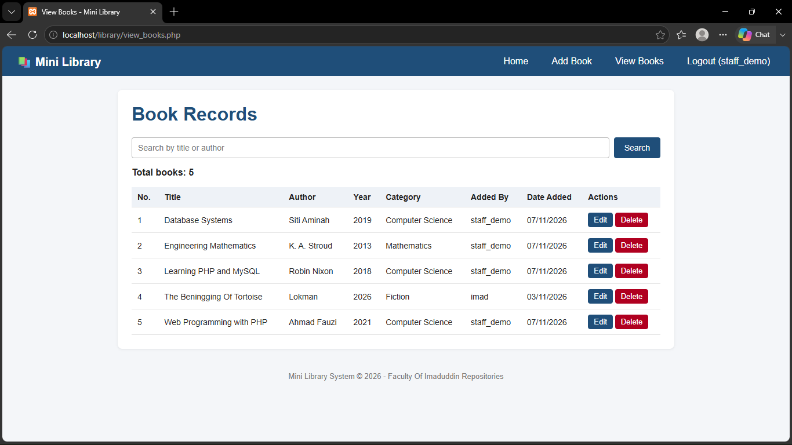
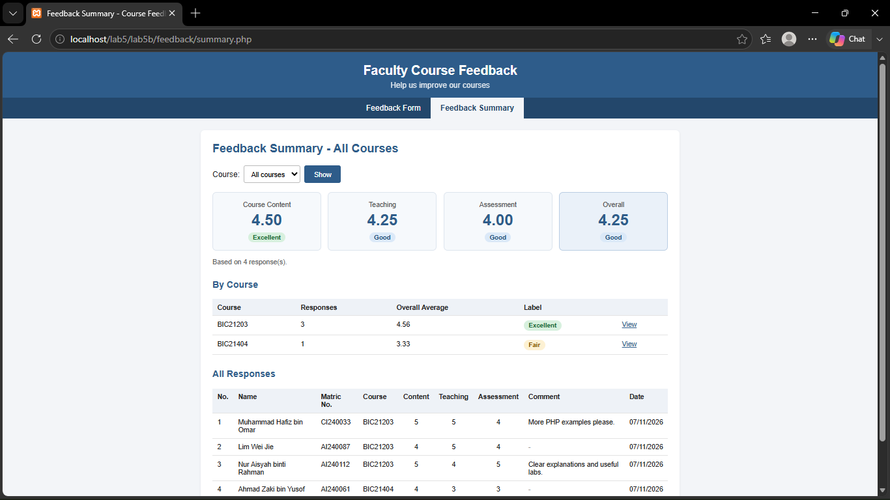
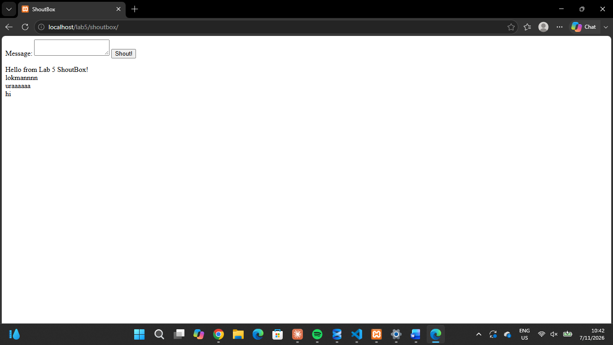
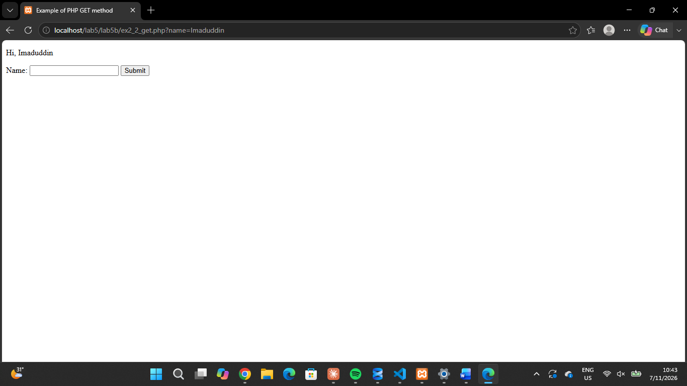

# Lab 5 – Server-Side Scripting with PHP and MySQL

BIC21203 Web Development · Muhammad Imaduddin bin Sumail (AI240041) · Section 8

## Folders

| Folder | Contents | Copy into `htdocs` as |
|---|---|---|
| `LAB5A/shoutbox` | Ex 2 – ShoutBox | `htdocs/lab5/shoutbox` |
| `LAB5A/mydb` | Ex 3 – Display data from database | `htdocs/lab5/mydb` |
| `LAB5A/register` | Ex 4 & 5 – Registration, login, insert/view/edit/delete | `htdocs/lab5/register` |
| `LAB5A/library` | Ex 6 – Mini Library System | `htdocs/library` |
| `LAB5B` | Ex 1 & 2 – Functions, include, forms (GET/POST) | `htdocs/lab5/lab5b` |
| `LAB5B/feedback` | Ex 3 – Course Feedback System | `htdocs/lab5/lab5b/feedback` |
| `database` | SQL exports of `library` and `course_feedback` | – |
| `screenshots` | Test screenshots used in the report | – |

## How to run

1. Start Apache and MySQL in XAMPP.
2. Copy the folders into `htdocs` as shown above (`htdocs/lab5/index.php` is the start page).
3. In phpMyAdmin, import `LAB5A/setup_ex2-5.sql`, `LAB5A/library/library.sql` and `LAB5B/feedback/feedback.sql`.
4. Open http://localhost/lab5/ (all exercises are linked there).

## Screenshots

| Mini Library | Course Feedback |
|---|---|
|  |  |
|  |  |